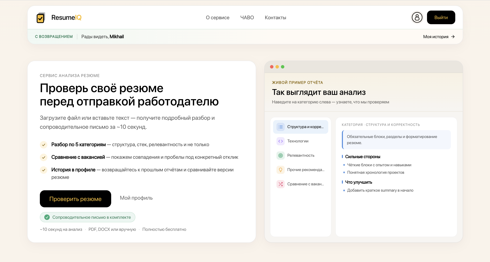
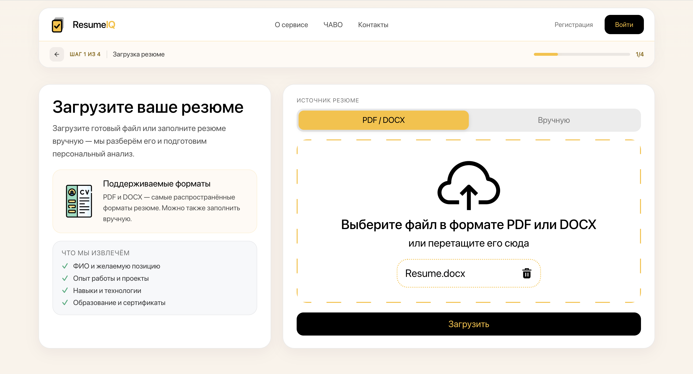
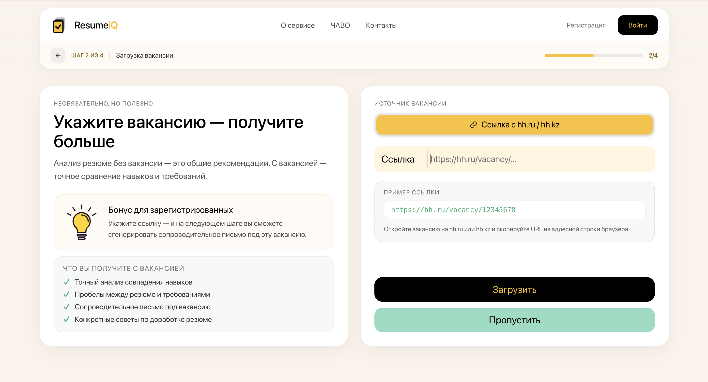
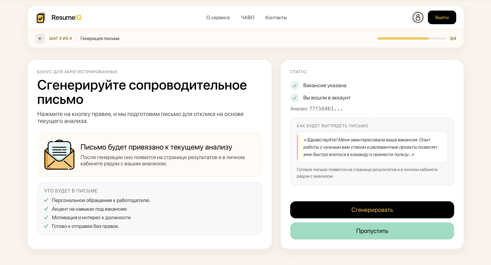
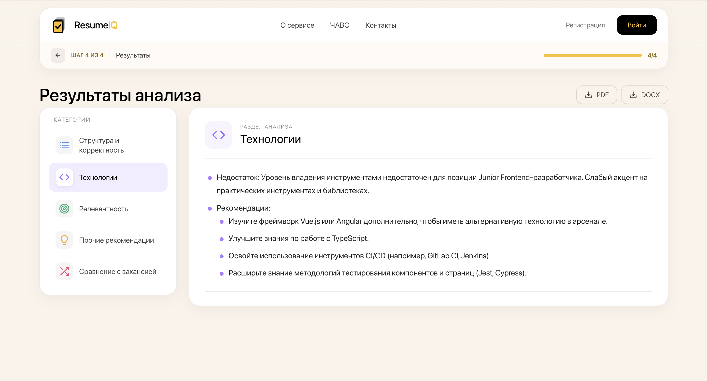
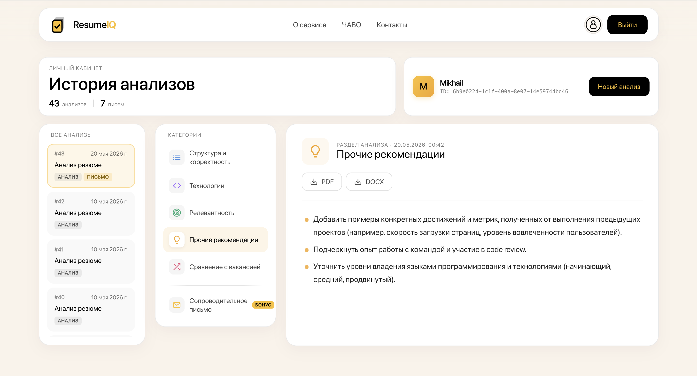

# CV Analyzer - Frontend

Веб-сервис для анализа резюме с помощью нейросети **GigaChat** от Сбера. Пользователь загружает резюме и ссылку на вакансию и получает рекомендации по улучшению резюме, сравнение его с требованиями вакансии и сгенерированное сопроводительное письмо.

В этом репозитории находится фронтенд-часть проекта. Бэкенд принимает резюме, обращается к GigaChat и отдаёт результаты через REST API.








## Возможности

- **Загрузка резюме** в формате PDF или DOCX через drag-and-drop с проверкой формата. Резюме также можно заполнить вручную через форму.
- **Сравнение с вакансией**: принимается ссылка на вакансию hh.ru (hh.ru / hh.kz) с валидацией. Шаг можно пропустить и получить общий анализ без привязки к вакансии.
- **Результаты анализа по категориям**: структура и корректность, технологии, релевантность, сравнение с вакансией и прочие рекомендации. Ответ модели рендерится из Markdown.
- **Генерация сопроводительного письма** под конкретную вакансию (для авторизованных пользователей).
- **Экспорт** анализа и письма в PDF (с поддержкой кириллицы) и DOCX, копирование письма в буфер обмена.
- **Регистрация и вход**, личный кабинет с историей всех анализов и писем.
- **Сохранение прогресса**: незавершённую проверку можно продолжить после перезагрузки страницы, а шапка подсказывает, с какого шага продолжить.
- **Адаптивная вёрстка** для мобильных устройств.

## Как это работает

1. Пользователь загружает резюме (файл или форма), фронтенд отправляет его на бэкенд и получает `cvId`.
2. На шаге вакансии пользователь вставляет ссылку на hh.ru или пропускает шаг. Фронтенд запускает анализ и получает `analysisId`.
3. На шаге сопроводительного письма авторизованный пользователь может запустить его генерацию или пропустить шаг.
4. Страница результатов опрашивает сервер (polling каждые 2 секунды): статус `202` означает, что анализ ещё идёт, `200` - что результат готов. Если ответа нет дольше 90 секунд, пользователь видит понятную ошибку вместо бесконечного лоадера.
5. Генерация письма идёт так же асинхронно, с поддержкой отмены запроса через `AbortController`.

## Технические детали

**Управление состоянием.** Redux Toolkit с тремя слайсами (`resume`, `auth`, `profile`) и асинхронными запросами через `createAsyncThunk`.

**Авторизация.** JWT с access- и refresh-токенами. Хук `useTokenRefresh` обновляет access-токен за 5 минут до истечения и разлогинивает пользователя, когда истекает refresh-токен. Чтобы несколько открытых вкладок не отправляли refresh одновременно (при ротации токенов это ломает сессию), обновление выполняется под блокировкой через **Web Locks API**.

**Хранение данных.** Состояние гостя хранится в `sessionStorage` и исчезает при закрытии вкладки. Состояние авторизованного пользователя хранится в `localStorage` и переживает перезапуск браузера. При входе, выходе и загрузке нового резюме устаревшие данные очищаются.

**Защита маршрутов.** Route guards (`RequireAuth`, `RequireCvId`, `RequireAnalysisId`) не пускают пользователя на шаг без нужных данных и перенаправляют его на ближайший осмысленный шаг.

**Экспорт документов.** Собственный парсер Markdown превращает ответ модели в блоки с сохранением жирного и курсива, а затем рендерит их в PDF (jsPDF со встроенным шрифтом Roboto для кириллицы) или DOCX (библиотека docx). Модули экспорта подгружаются динамически, только когда пользователь нажимает кнопку.

## Стек

- **React 19**, **Vite**
- **Redux Toolkit**, **React Redux**
- **React Router 7**
- **SCSS Modules**, **Chakra UI**, normalize.css
- **react-markdown**, **react-toastify**, **react-icons**
- **jsPDF**, **docx** - генерация файлов для экспорта
- **ESLint**
- **Docker** (multi-stage сборка: Bun → Nginx)

## Структура проекта

```text
src/
├── assets/          # Изображения и шрифты
├── components/      # Переиспользуемые компоненты (Header, Dropzone, ManualFields, TextArea, Loader, Disclosure)
│   ├── guards/      # Защита маршрутов
│   └── ui/          # Провайдеры и компоненты Chakra UI
├── config/          # URL API, шаги мастера, категории анализа
├── hooks/           # useTokenRefresh
├── pages/           # Страницы приложения
├── redux/           # Store и слайсы (resume, auth, profile)
├── styles/          # Глобальные стили и шрифты
├── utils/           # Экспорт в PDF и DOCX
├── App.jsx          # Маршруты
└── main.jsx         # Точка входа
```

## Страницы

| Маршрут | Описание |
|---|---|
| `/` | Главная страница с описанием сервиса |
| `/uploadresume` | Загрузка резюме файлом или вручную |
| `/uploadvacancy` | Ссылка на вакансию hh.ru |
| `/generateletter` | Генерация сопроводительного письма |
| `/resultspage` | Результаты анализа и письмо, экспорт |
| `/login` | Вход и регистрация |
| `/myprofile` | Личный кабинет с историей анализов |
| `/about` | О проекте |

## Запуск

Создайте файл `.env` по примеру `.env.example` и укажите адрес бэкенда:

```bash
VITE_API_URL=http://localhost:8080
```

Установка зависимостей и запуск dev-сервера:

```bash
bun install
bun run dev
```

Или через npm:

```bash
npm install
npm run dev
```

Production-сборка:

```bash
bun run build
bun run preview
```

## Docker

```bash
docker build -t cv-analyzer-frontend .
docker run -p 80:80 cv-analyzer-frontend
```

Сборка проходит в два этапа: зависимости ставятся и проект собирается через Bun, а статика раздаётся через Nginx с fallback на `index.html` для клиентского роутинга и кэшированием статических файлов.

> Переменная `VITE_API_URL` подставляется на этапе сборки, поэтому файл `.env` должен быть в проекте до запуска `docker build`.

## Автор

Rinkiari - фронтенд-разработка
